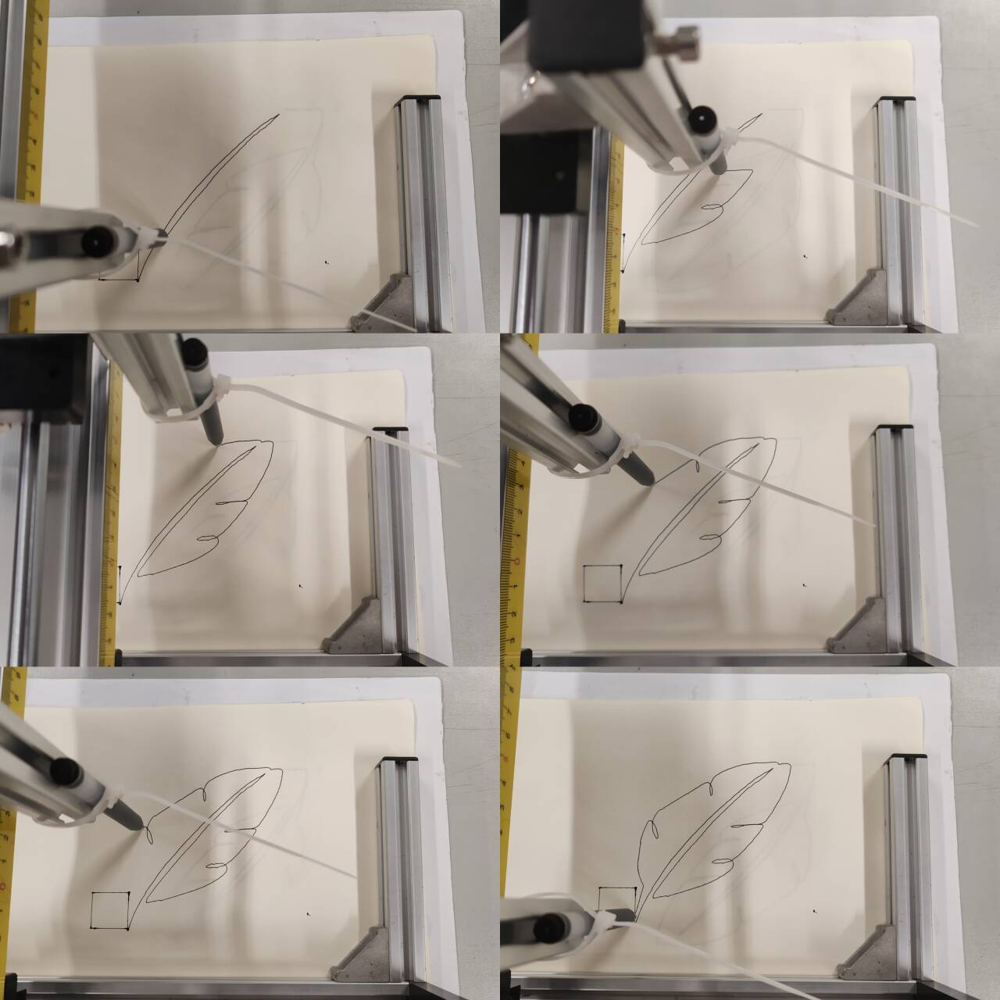
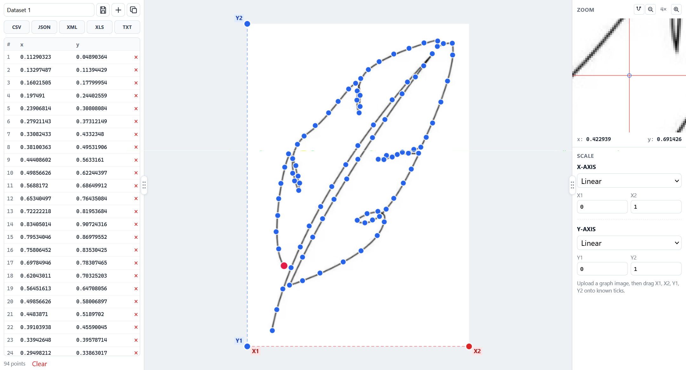
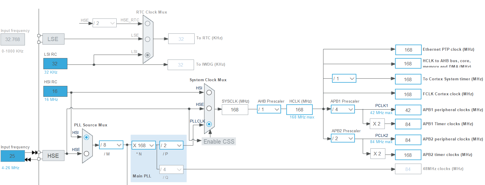
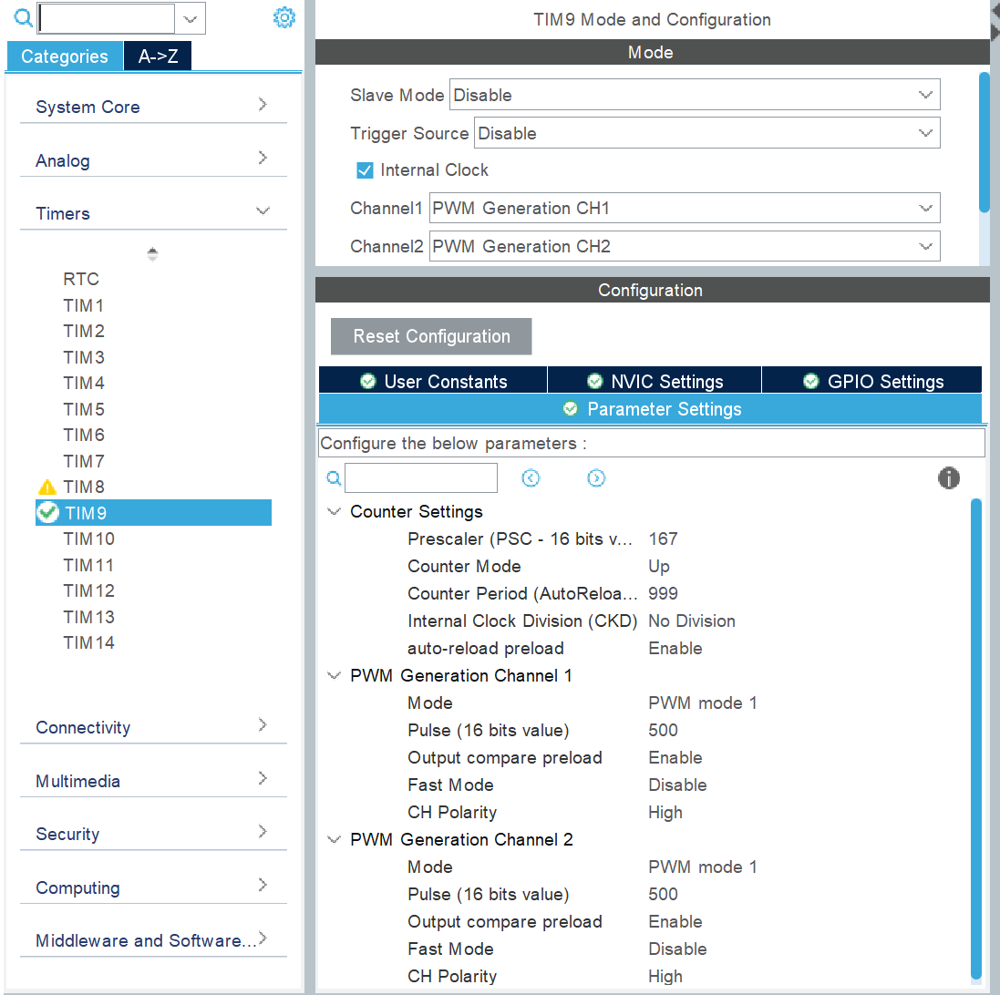
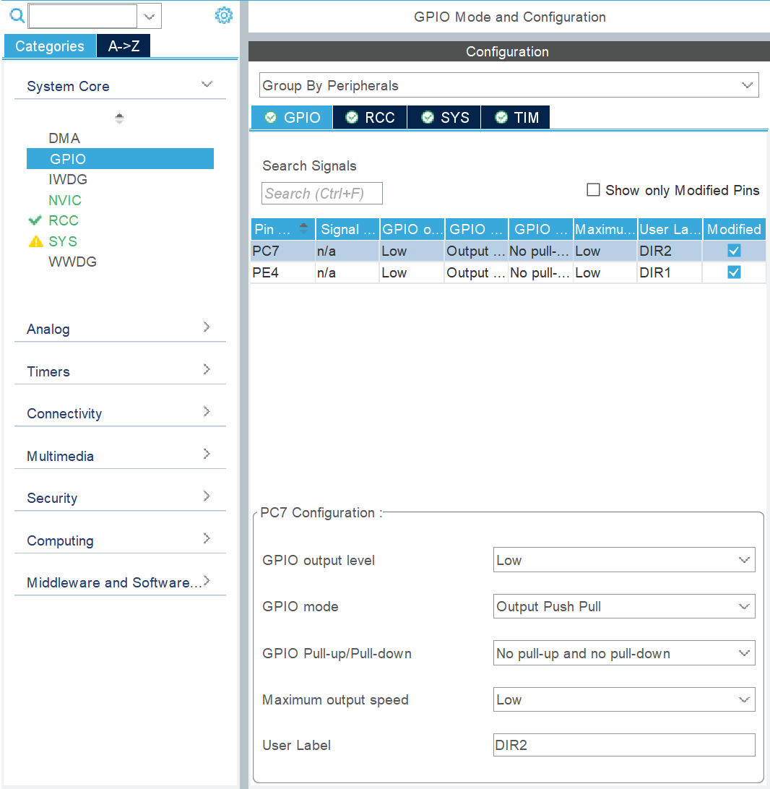
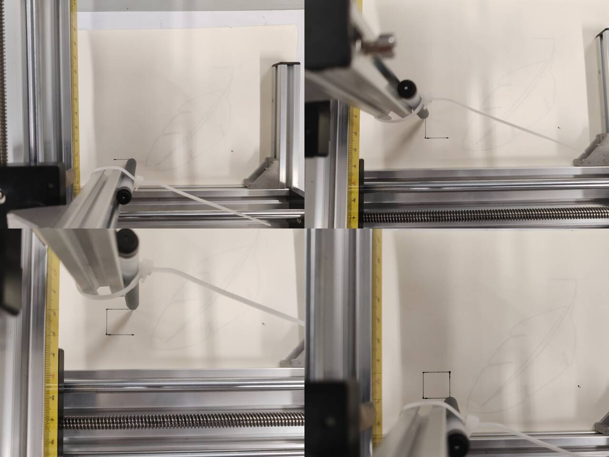

# 基于 STM32F407 的二维滑台自动绘图系统

用 STM32F407 控制 XY 二维滑台，实现双轴点动、软件设原点、步距标定，以及手绘叶子轨迹的自动绘制。

<p align="center">
  
</p>

<p align="center"><b>图 1</b> 实物绘制过程（叶子轮廓）</p>

---

## 功能特性

- **双轴点动**：X± / Y±，按住按键连续运动，松手即停  
- **软件原点**：将当前位置记为 `(0,0)`（约定工作区左下角）  
- **步距标定**：固定输出 1000 脉冲，便于尺子实测后计算 `steps/mm`  
- **直线插补**：Bresenham 双轴联动，避免“先横后竖”  
- **自动绘图**：按点表绘制手绘叶子（长边约 10 cm）  
- **软限位**：X ≤ 200 mm，Y ≤ 160 mm  

## 硬件组成

| 项目 | 说明 |
|------|------|
| 主控 | 霸天虎 STM32F407ZGT6 |
| 驱动 | TB6600 类步进驱动 ×2 |
| 执行 | 步进电机 ×2 + 铝型材二维滑台 |
| 人机 | SW3 切换模式，SW1 确认/点动，蜂鸣器提示 |
| 调试 | CMSIS-DAP / SWD |

### 引脚连接

| 功能 | 引脚 | 说明 |
|------|------|------|
| Y 脉冲 | **PE5** | TIM9_CH1 |
| Y 方向 | **PE4** | DIR1 |
| X 脉冲 | **PE6** | TIM9_CH2 |
| X 方向 | **PC7** | DIR2 |
| 模式键 SW3 | PC13 | 切换功能 |
| 确认键 SW1 | PA0 | 点动按住 / 其他单击 |
| 蜂鸣器 | PG7 | 提示音 |

驱动器建议共阴极：`PUL-`/`DIR-` → MCU GND，`PUL+`/`DIR+` → 对应引脚；电机电源与 MCU **共地**。

### 坐标系

```
        +Y 向上（≤160 mm）
         ↑
         │
         └────────→ +X 向右（≤200 mm）
       (0,0) 工作区左下角 = 叶子叶柄起笔点
```

---

## 仓库结构

```
MOVE/
├── Core/Src/main.c          # 按键菜单、模式状态机
├── Core/Src/plotter.c       # 运动引擎：点动 / 插补 / 标定
├── Core/Src/drawings.c      # 叶子点表与 Drawing_Leaf()
├── Core/Inc/                # 头文件
├── MDK-ARM/                 # Keil 工程
├── MOVE.ioc                 # CubeMX 工程
├── images/                  # 配图
└── README.md
```

---

## 软件架构

```
应用层   main.c        模式切换、蜂鸣、调用绘图/标定
   │
图案层   drawings.c    叶子毫米坐标点列
   │  MoveTo / LineTo
运动层   plotter.c     步距、软限位、Bresenham、PWM/GPIO 脉冲
   │
HAL      tim / gpio    CubeMX 生成
```

### 按键模式一览

| 模式 | 功能 |
|------|------|
| 0–3 | X+ / X− / Y+ / Y− 点动 |
| 4 | 设软件原点 |
| 5 | 画叶子 |
| 6 | 标定 X（发 1000 脉冲，X+） |
| 7 | 标定 Y（发 1000 脉冲，Y+） |

标定公式：

```text
步距 K (steps/mm) = 1000 / 实测位移(mm)
```

本仓库默认按实测写入：`K = 50`（1000 脉冲 ≈ 20 mm）。

---

## 图案数据来源

叶子轮廓用轨迹点采集工具按画笔顺序取点，再平移到原点、缩放后写入 `drawings.c`。

<p align="center">
  
</p>

<p align="center"><b>图 2</b> 叶子轨迹数字化取点（源点约 94 个，平滑加密后约 375 个绘制点）</p>

---

## CubeMX 配置要点

### 时钟

HSE 25 MHz → PLL → **SYSCLK 168 MHz**；APB2 定时器时钟 168 MHz（供 TIM9）。

<p align="center">
  
</p>

<p align="center"><b>图 3</b> CubeMX 时钟配置</p>

### TIM9 双通道 PWM

| 参数 | 值 |
|------|-----|
| Prescaler | 167 |
| Period (ARR) | 999 |
| Pulse | 500 |
| CH1 / CH2 | PE5 (Y) / PE6 (X) |

```text
f_PWM = 168 MHz / [(167+1)×(999+1)] = 1 kHz
```

<p align="center">
  
</p>

<p align="center"><b>图 4</b> TIM9 PWM 参数（PSC=167，ARR=999 → 约 1 kHz）</p>

### 方向 GPIO

PE4 → `DIR1`（Y），PC7 → `DIR2`（X），推挽输出。

<p align="center">
  
</p>

<p align="center"><b>图 5</b> 方向脚 GPIO 配置</p>

---

## 编译与下载

1. 用 **STM32CubeMX** 打开 `MOVE.ioc`  
2. 用 **Keil MDK-5** 打开 `MDK-ARM` 下工程  
3. 确认已加入 `plotter.c`、`drawings.c`  
4. Rebuild → 通过 CMSIS-DAP Download  
5. 上电后按下面流程操作  

### 推荐操作流程

1. SW3 切到点动，把滑台挪到工作区**左下角**  
2. 切到「设原点」，按 SW1  
3. 切到「画叶子」，按 SW1 开始  
4. （可选）用「标定 X/Y」重新测步距，修改 `plotter.c` 中：

```c
#define PLOT_STEPS_PER_MM_X     50.0f
#define PLOT_STEPS_PER_MM_Y     50.0f
```

---

## 实物效果

点动/直线运动联调（方框轨迹）：

<p align="center">
  
</p>

<p align="center"><b>图 6</b> 方框轨迹测试</p>

叶子自动绘制过程见文首 **图 1**。

---

## 关键参数速查

| 参数 | 数值 |
|------|------|
| 主频 | 168 MHz |
| 脉冲频率 | ≈ 1 kHz |
| 步距 | 50 steps/mm |
| 软限位 | X 200 mm / Y 160 mm |
| 叶子尺寸 | 长边约 10 cm |
| 点动速度（约） | 1000/50 ≈ 20 mm/s |
